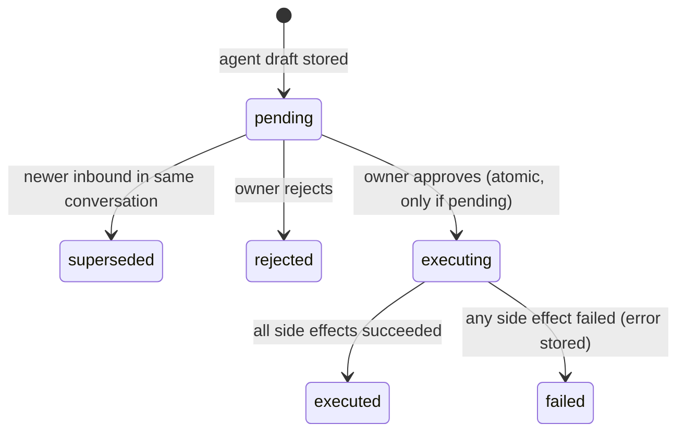

# Architecture

Everything here is a contract. Lane 2 implements the schema and the shared package exactly as written. Lanes 1 and 3 code against it from minute one, before lane 2 has finished.

## System


### Rules the architecture enforces

1. **Agents never write and never send.** `packages/agents` receives a read-only `AgentDataPort` and returns `ProposalDraft[]`. It has no Supabase client, no Photon client, no Square client.
2. **Only the approve endpoint executes.** `POST /proposals/:id/approve` is the only code path that sends a customer message, creates a payment link, or records a reorder.
3. **The server prices orders.** Agents propose product IDs and quantities. The server computes every price from the `products` table. An LLM never produces a dollar amount that reaches Square.
4. **The browser reads, never writes, the database.** Row level security allows `select` only. All writes go through the server with the owner token.
5. **Evidence is computed, not generated.** Evidence chips come from deterministic lookups in the agents package, so the "why" shown on a ticket is always true.
6. **Everything leaves a trace.** Every inbound message, agent step, proposal, decision, execution, payment, and failure is a row in `events`.

These rules are also the story we tell VEYZL and the judges: human oversight, no unpriced LLM output in payments, full audit trail.

## Repo layout

```
.
├── package.json              # lane 2: workspace root scripts
├── pnpm-workspace.yaml       # lane 2
├── tsconfig.base.json        # lane 2
├── .env.example              # lane 2: names only
├── apps/
│   ├── web/                  # lane 1: Next.js control room + /join + /audit
│   └── server/               # lane 2: Hono API, Photon listener, Square, executor
├── packages/
│   ├── shared/               # lane 2 creates; contract; additive edits by anyone
│   └── agents/               # lane 3: agent pipeline, evals, fixture data port
├── supabase/
│   └── migrations/           # lane 2
├── data/
│   ├── seed/                 # lane 3: synthetic bakery JSON
│   └── evals/                # lane 3: eval cases
├── scripts/
│   ├── seed.ts               # lane 2: loads data/seed into Supabase + Square
│   ├── reset.ts              # lane 2: wipes demo state, reseeds
│   ├── generate-history.ts   # lane 3: writes data/seed/orders.json
│   └── photon-ping.ts        # lane 3: first-hour Photon round-trip test
├── docs/                     # shared context (main only)
└── planning/                 # this plan (main only)
```

Package names: `@boh/web`, `@boh/server`, `@boh/shared`, `@boh/agents`.

## Tech stack

One language end to end: **TypeScript on Node.js**, in a **pnpm monorepo**. A **Next.js** control room reads **Supabase Postgres** live through **Supabase Realtime**. A long-running **Hono** server owns every write and every side effect. It talks to **Photon 2.0 beta** for iMessage and **Square sandbox** for payments, and runs the agents, which are built on the **Vercel AI SDK**. There is no ORM, no separate job queue, no Docker, and no second language.

Versions below were the latest published on 2026-10-17. Install with a caret range on the listed major. Do not change a major version during the hackathon without a `docs/DECISIONS.md` row, because three agents share one lockfile.

### By layer

| Layer | Choice | Version | Used in | Why this and not something else |
| --- | --- | --- | --- | --- |
| Runtime | Node.js | 24 (CI, demo host); 22 works for local server dev | everything | Photon's beta walkthroughs target Node 24 |
| Package manager | pnpm workspaces | 10 | root | One lockfile, fast installs, `workspace:*` links. Install with `npm i -g pnpm@10`; older corepack versions fail pnpm's signature check |
| Language | TypeScript, strict, ESM | 5.9 | everything | Shared types across all three lanes |
| Run TS directly | tsx | 4 | server, scripts | No build step for the server or scripts |
| Validation | zod | 4 | shared, server, agents | One schema for runtime checks, model structured output, and TS types |
| Env loading | dotenv | 17 | server, scripts | Reads the root `.env` |
| Database | Supabase Postgres | hosted, free tier | server (writes), web (reads) | Postgres with realtime and row level security included; MCP access for migrations |
| DB client | `@supabase/supabase-js` | 2 | server (service role), web (anon key) | Same client for queries and realtime subscriptions |
| Live updates | Supabase Realtime (`postgres_changes`) | included | web | No websocket server of our own |
| HTTP server | Hono + `@hono/node-server` | 4 + 1.19 (installed) | server | Small, typed, raw-body access for webhook signatures |
| Messaging | Photon 2.0 beta: `@photon-ai/api` | 0.5 | server, `scripts/photon-ping.ts` | Sponsor track requirement; real iMessage |
| Photon events | `socket.io-client` | 4 | server | Photon's beta event stream is Socket.IO with replay cursors |
| Payments | Square sandbox, `square` SDK | 46 | server, seed | Free sandbox, payment links, signed webhooks, no partner approval |
| Agents | Vercel AI SDK (`ai`) | 7 | agents | Provider-agnostic structured output with zod; one model ID swap |
| Model access | Vercel AI Gateway (`AI_GATEWAY_API_KEY`), or a direct provider package | gateway 4 | agents | One key, any model; record the model in `docs/DECISIONS.md` |
| Web framework | Next.js App Router + React | 16 + 19 | web | Route handlers proxy owner actions, so the owner token stays server side |
| Styling | Tailwind CSS | 4 | web | Fast iteration on the "pass" design tokens |
| Components | shadcn/ui (CLI `shadcn`) | 4 | web | Accessible primitives (sheet, dialog, tooltip) we own and restyle |
| Motion | `motion` | 14 | web | Ticket slide-in and stamp animations |
| Icons | `lucide-react` | 1 | web | |
| Dates | `date-fns` (+ `Intl.DateTimeFormat` for time zones) | 4 | web, server, agents | Business-timezone math without a heavy library |
| QR codes | `qrcode.react` | 4 | web (`/join/qr`) | |
| Unit tests | Vitest | 5 | agents, server | Fast, TS-native; CI runs any `test` script |
| Lint | ESLint (Next.js default config) | bundled | web | Other packages rely on `tsc --strict` |
| CI | GitHub Actions | | repo | `.github/workflows/ci.yml`; check named `build` |
| Tunnel | ngrok, free static domain | | demo host | Square webhooks reach the laptop at a stable URL |
| Hosting | Server on the demo laptop; web on localhost or Vercel | | | The server holds a long-lived Photon socket, so it is not a serverless function |

### Dependencies per package

| Package | Dependencies | Dev dependencies |
| --- | --- | --- |
| root | | `typescript`, `tsx`, `@types/node`, `dotenv` |
| `@boh/shared` | `zod` | |
| `@boh/server` | `@boh/shared`, `@boh/agents` (once merged), `hono`, `@hono/node-server`, `@supabase/supabase-js`, `@photon-ai/api`, `socket.io-client`, `square`, `zod`, `dotenv` | `vitest` |
| `@boh/agents` | `@boh/shared`, `ai`, `zod` (+ `@ai-sdk/gateway` or a provider package if not using the string model ID) | `vitest`, `tsx` |
| `@boh/web` | `@boh/shared`, `next`, `react`, `react-dom`, `@supabase/supabase-js`, `motion`, `lucide-react`, `date-fns`, `qrcode.react`, shadcn's generated deps (`class-variance-authority`, `clsx`, `tailwind-merge`, Radix packages) | `tailwindcss`, `eslint`, `@types/react` |

Every package defines `typecheck`. Add `test`, `lint`, and `build` scripts where they apply; CI picks them up automatically.

### How the packages connect

Workspace packages are consumed as TypeScript source (`"exports": { ".": "./src/index.ts" }`), with no build step between them. The server and scripts run them through `tsx`. Next.js compiles them through `transpilePackages: ["@boh/shared"]`. The web app never imports `@boh/agents` or the server; it talks to Supabase (reads) and to the server over HTTP (actions).

### Not in the stack

These are deliberately out of scope. Agents should not add them:

- `spectrum-ts` and the stable Photon docs (a different product from Photon 2.0 beta)
- Twilio, Instagram, Gmail, or Toast integrations
- An ORM (Prisma, Drizzle) or a second database
- Express, Fastify, tRPC, GraphQL
- Redux or another global state library (React context and a reducer are enough; Zustand is acceptable if needed)
- Docker or Kubernetes
- Python or any second language

### Photon 2.0 beta facts that shape the design

Verified against the beta docs on 2026-10-17. Re-check if something fails.

- API origin `https://api.photon.codes`, bearer auth with a project API key (`pho_sk_...`). Project IDs start with `pho_prj_`. Do not use `spectrum-ts` or the stable docs; that is a different product.
- A **shared iMessage line only receives messages from senders assigned to it.** Each sender handle (E.164 phone or iMessage email) needs an assignment, and the assigned agent number can differ per sender. The Free plan allows 25 shared assignments per project.
- A shared line **cannot send the first message.** The customer must text first. Proactive outreach (win-back blasts) is impossible on the demo line, which is why win-back is an in-conversation perk, not a campaign.
- Shared assignments support **direct conversations only**, not group chats, and no voice.
- Inbound arrives over a **Socket.IO event stream** with a replay cursor (`seq`), or by polling `listMessages`. No public webhook URL is needed for Photon.
- Outbound: `photon.projects.sendMessage` with the incoming message's `space.id` as `spaceId`, the receiving agent's `receivedBy.id` as `senderId`, an optional `parentMessageId`, and a stable `idempotency-key`.
- Assigning a sender from code: `photon.projects.platforms.imessage.assignments.create` with `body: { handle }` and an idempotency key. It needs the `platforms:write` permission and returns `assignedPhoneNumber`.
- Sends are accepted asynchronously. "Accepted" is not "delivered."

## Database schema

Lane 2 saves this as `supabase/migrations/0001_init.sql` and applies it. Do not edit it after it lands; add `0002_*.sql` and later files instead.

```sql
create extension if not exists pgcrypto;

create table customers (
  id uuid primary key default gen_random_uuid(),
  name text not null,
  handle text unique,
  square_customer_id text unique,
  notes text,
  is_demo_persona boolean not null default false,
  created_at timestamptz not null default now()
);

create table products (
  id text primary key,
  name text not null,
  category text not null check (category in ('pastry','bread','drink','cake','savory')),
  price_cents integer not null check (price_cents >= 0),
  daily_capacity integer not null check (daily_capacity >= 0),
  aliases text[] not null default '{}',
  active boolean not null default true
);

create table ingredients (
  id text primary key,
  name text not null,
  unit text not null,
  on_hand numeric not null,
  on_order numeric not null default 0,
  reorder_point numeric not null,
  supplier text not null,
  unit_cost_cents integer not null
);

create table recipe_lines (
  product_id text not null references products(id) on delete cascade,
  ingredient_id text not null references ingredients(id),
  qty_per_unit numeric not null check (qty_per_unit > 0),
  primary key (product_id, ingredient_id)
);

create table conversations (
  id uuid primary key default gen_random_uuid(),
  customer_id uuid references customers(id),
  handle text not null,
  role text not null default 'customer' check (role in ('customer','owner')),
  platform text not null default 'imessage' check (platform in ('imessage','simulated')),
  photon_space_id text unique,
  photon_agent_user_id text,
  last_message_at timestamptz not null default now(),
  created_at timestamptz not null default now()
);

create table messages (
  id uuid primary key default gen_random_uuid(),
  conversation_id uuid not null references conversations(id) on delete cascade,
  direction text not null check (direction in ('inbound','outbound')),
  body text not null,
  photon_message_id text unique,
  status text not null check (status in ('received','queued','sent','failed')),
  created_at timestamptz not null default now()
);
create index messages_conversation_idx on messages (conversation_id, created_at);

create table proposals (
  id uuid primary key default gen_random_uuid(),
  agent text not null check (agent in ('intake','ops','winback')),
  kind text not null check (kind in ('reply','reorder')),
  status text not null default 'pending'
    check (status in ('pending','executing','executed','rejected','superseded','failed')),
  conversation_id uuid references conversations(id),
  trigger_message_id uuid references messages(id),
  parent_proposal_id uuid references proposals(id),
  title text not null,
  summary text not null,
  rationale text not null default '',
  payload jsonb not null,
  evidence jsonb not null default '[]',
  reads jsonb not null default '[]',
  confidence numeric check (confidence between 0 and 1),
  risk_flags text[] not null default '{}',
  short_code text unique,
  owner_notified_at timestamptz,
  created_at timestamptz not null default now(),
  decided_at timestamptz,
  executed_at timestamptz,
  error text
);
create index proposals_status_idx on proposals (status, created_at desc);

create table orders (
  id uuid primary key default gen_random_uuid(),
  customer_id uuid references customers(id),
  source text not null check (source in ('history','agent')),
  status text not null check (status in ('awaiting_payment','paid','fulfilled','cancelled')),
  pickup_at timestamptz not null,
  total_cents integer not null,
  discount_cents integer not null default 0,
  square_order_id text,             -- shared by both orders of a split counteroffer
  square_payment_link_id text,
  payment_url text,
  proposal_id uuid references proposals(id),
  created_at timestamptz not null default now(),
  paid_at timestamptz
);
create index orders_square_idx on orders (square_order_id);
create index orders_customer_idx on orders (customer_id, created_at desc);
create index orders_pickup_idx on orders (pickup_at);

create table order_items (
  order_id uuid not null references orders(id) on delete cascade,
  product_id text not null references products(id),
  qty integer not null check (qty > 0),
  unit_price_cents integer not null,
  primary key (order_id, product_id)
);

create table events (
  id bigserial primary key,
  at timestamptz not null default now(),
  actor text not null,
  type text not null,
  subject_type text,
  subject_id text,
  data jsonb not null default '{}'
);
create index events_subject_idx on events (subject_type, subject_id);

create table photon_cursor (
  id integer primary key default 1 check (id = 1),
  seq bigint not null default 0
);
insert into photon_cursor (id, seq) values (1, 0);

alter publication supabase_realtime
  add table conversations, messages, proposals, orders, ingredients, events;

do $$
declare t text;
begin
  foreach t in array array[
    'customers','products','ingredients','recipe_lines','conversations',
    'messages','proposals','orders','order_items','events'
  ] loop
    execute format('alter table %I enable row level security', t);
    execute format('create policy "browser read" on %I for select to anon, authenticated using (true)', t);
  end loop;
end $$;

alter table photon_cursor enable row level security;
```

The browser can read every table, including synthetic customer names and handles. That is acceptable for a demo with synthetic data, and it is a likely VEYZL finding worth fixing if time allows (for example by masking handles in a view).

### Event vocabulary

`actor` is one of `customer`, `owner`, `system`, `photon`, `square`, `agent:intake`, `agent:ops`, `agent:guard`.

| `type` | Written by | Subject |
| --- | --- | --- |
| `message.received` | server | message |
| `message.sent` / `message.failed` | server | message |
| `agent.step` | server, from `ctx.trace` | the trigger message; `data.step`, `data.ms`, `data.detail` |
| `proposal.created` | server | proposal |
| `proposal.approved` / `proposal.rejected` / `proposal.superseded` | server | proposal; `data.edited` when text changed |
| `proposal.executed` / `proposal.failed` | server | proposal |
| `order.created` / `order.paid` | server | order |
| `payment_link.created` | server | order |
| `inventory.deducted` / `inventory.reordered` | server | ingredient |
| `customer.joined` | server | customer |
| `guard.flagged` | server, when a stored draft carries `injection_suspected`, `off_policy`, or `abusive` | proposal; `data.flags` |
| `owner.notified` | server | proposal; the iMessage sent to the owner |
| `owner.command` | server | proposal; `data.command` (`approve`, `reject`, `list`, `unknown`) |
| `winback.scanned` | server | none; `data.candidates` |
| `demo.reset` | reset script | none |

### Trace detail shape

Every `agent.step` event's `data` has this shape so the UI can render it without special cases:

```json
{
  "agent": "intake | ops | guard | winback",
  "step": "context | understand | resolve | ops_check | plan | draft | guard",
  "ms": 812,
  "summary": "One line a judge can read, e.g. 'Saturday butter croissants: 12 of 36 committed'",
  "reads": [{ "table": "orders", "id": "..." }],
  "flags": ["capacity_shortfall"]
}
```

### Friction saved

The control room shows a running tally computed from `events` since the last `demo.reset`. Nothing is hard-coded.

| Counter | Counted from |
| --- | --- |
| Messages handled | `proposal.executed` where the proposal kind is `reply` |
| Orders created | `order.created` |
| Reorders drafted | `proposal.created` where kind is `reorder` |
| Guard catches | `guard.flagged` |
| Owner minutes saved (est.) | Sum over executed proposals of `BusinessProfile.minutesSaved[...]` by type: reply, order, counteroffer (a reply with two orders or the `counteroffer` flag), reorder, guard catch |

The estimate's assumptions are visible in a tooltip, for example "≈3 min per reply typed by hand, ≈6 min to check stock and call a supplier."

## Shared contracts

Lane 2 creates `packages/shared/src/index.ts` with exactly this content (split into files if preferred, but keep these exported names).

```ts
import { z } from "zod";

export const ProductId = z.string().min(1);
export const IsoDateTime = z.iso.datetime({ offset: true });

export const AgentName = z.enum(["intake", "ops", "winback"]);
export const ProposalKind = z.enum(["reply", "reorder"]);
export const ProposalStatus = z.enum([
  "pending", "executing", "executed", "rejected", "superseded", "failed",
]);

export const RiskFlag = z.enum([
  "new_customer",
  "low_confidence",
  "large_order",
  "capacity_shortfall",
  "ingredient_shortfall",
  "outside_hours",
  "short_notice",
  "allergy_mentioned",
  "injection_suspected",
  "needs_clarification",
  "complaint",
  "counteroffer",        // the agent could not do what was asked and proposes an alternative
  "off_policy",          // asked for free items, unlisted discounts, other customers' data, etc.
  "abusive",
  "off_topic",
]);

export const RecordRef = z.object({ table: z.string(), id: z.string() });

export const Evidence = z.object({
  label: z.string(),
  value: z.string(),
  source: RecordRef.optional(),
});

export const OrderLine = z.object({ productId: ProductId, qty: z.number().int().positive() });

export const OrderDraft = z.object({
  items: z.array(OrderLine).min(1),
  pickupAt: IsoDateTime,
  perk: z.enum(["welcome_back_10"]).optional(),
});

/** Zero orders: a plain reply. One: a normal order. Two: a split counteroffer (e.g. 24 Saturday + 24 Sunday) behind one payment link. */
export const ReplyPayload = z.object({
  text: z.string().min(1).max(1200),
  orders: z.array(OrderDraft).max(2).default([]),
});

export const ReorderPayload = z.object({
  supplier: z.string(),
  lines: z.array(z.object({ ingredientId: z.string(), qty: z.number().positive() })).min(1),
  neededBy: IsoDateTime.optional(),
});

const DraftBase = z.object({
  agent: AgentName,
  title: z.string().max(80),
  summary: z.string().max(280),
  /** One line: why the agent proposes this, in plain words. Shown on the ticket face. */
  rationale: z.string().max(160),
  evidence: z.array(Evidence),
  /** Every record the agent read to build this draft. The ticket shows counts by table. */
  reads: z.array(RecordRef),
  confidence: z.number().min(0).max(1),
  riskFlags: z.array(RiskFlag),
  /** Index of another draft in the same returned array that this one depends on. */
  parentIndex: z.number().int().nonnegative().optional(),
});

export const ProposalDraft = z.discriminatedUnion("kind", [
  DraftBase.extend({ kind: z.literal("reply"), payload: ReplyPayload }),
  DraftBase.extend({ kind: z.literal("reorder"), payload: ReorderPayload }),
]);

export type RecordRef = z.infer<typeof RecordRef>;
export type Evidence = z.infer<typeof Evidence>;
export type RiskFlag = z.infer<typeof RiskFlag>;
export type OrderLine = z.infer<typeof OrderLine>;
export type OrderDraft = z.infer<typeof OrderDraft>;
export type ReplyPayload = z.infer<typeof ReplyPayload>;
export type ReorderPayload = z.infer<typeof ReorderPayload>;
export type ProposalDraft = z.infer<typeof ProposalDraft>;
export type ProposalStatus = z.infer<typeof ProposalStatus>;

/** The placeholder the server replaces with the Square payment link URL at execution time. */
export const PAYMENT_LINK_TOKEN = "{{payment_link}}";

export interface BusinessProfile {
  name: string;
  timezone: string;                 // "America/Los_Angeles"
  hours: Record<"mon"|"tue"|"wed"|"thu"|"fri"|"sat"|"sun", { open: string; close: string } | null>;
  minLeadHours: number;             // ordinary pre-orders
  cateringThresholdUnits: number;   // at or above this many units, treat as catering
  cateringLeadHours: number;
  largeOrderCents: number;          // flag above this total
  welcomeBackAfterDays: number;     // perk eligibility
  winbackOverdueFactor: number;     // flag a regular when days since last order > factor × their median interval
  winbackMinOrders: number;         // only customers with at least this many orders count as regulars
  minutesSaved: { reply: number; order: number; counteroffer: number; reorder: number; guardCatch: number };
  voice: string;                    // one paragraph describing how the shop texts
  poweredByFooter: string;          // appended by the server to every customer reply
}

export interface RegularCadence {
  customerId: string;
  name: string;
  orderCount: number;
  medianIntervalDays: number;
  daysSinceLast: number;
  hasOpenConversation: boolean;     // a Photon space exists, so the line can message them
}

export interface CustomerProfile {
  id: string;
  name: string;
  handle: string | null;
  notes: string | null;
  isDemoPersona: boolean;
}

export interface OrderSummary {
  id: string;
  createdAt: string;
  pickupAt: string;
  status: "awaiting_payment" | "paid" | "fulfilled" | "cancelled";
  totalCents: number;
  items: { productId: string; name: string; qty: number }[];
}

export interface Product {
  id: string;
  name: string;
  category: "pastry" | "bread" | "drink" | "cake" | "savory";
  priceCents: number;
  dailyCapacity: number;
  aliases: string[];   // "croissants" → butter croissant
  active: boolean;
}

export interface DayLoad {
  productId: string;
  committed: number;   // units in awaiting_payment + paid orders for that local date
  capacity: number;
}

export interface IngredientNeed {
  ingredientId: string;
  name: string;
  unit: string;
  need: number;        // for the requested items plus everything already committed that day
  onHand: number;
  onOrder: number;
  shortfall: number;   // max(0, need - onHand - onOrder)
  supplier: string;
}

export interface ConversationContext {
  id: string;
  handle: string;
  customerId: string | null;
  messages: { id: string; direction: "inbound" | "outbound"; body: string; createdAt: string }[];
}

/** Read-only access the server gives to agents. Lane 2 implements it on Supabase; lane 3 implements it on fixtures. */
export interface AgentDataPort {
  getConversation(conversationId: string, limit?: number): Promise<ConversationContext>;
  getCustomer(customerId: string): Promise<CustomerProfile | null>;
  getCustomerByHandle(handle: string): Promise<CustomerProfile | null>;
  getOrderHistory(customerId: string, limit?: number): Promise<OrderSummary[]>;
  getCatalog(): Promise<Product[]>;
  getDayLoad(localDate: string): Promise<DayLoad[]>;   // "YYYY-MM-DD" in business timezone
  getIngredientNeeds(items: OrderLine[], localDate: string): Promise<IngredientNeed[]>;
  getPendingProposals(conversationId: string): Promise<{ id: string; kind: "reply" | "reorder"; summary: string }[]>;
  /** Next open days after localDate with remaining capacity per product, for counteroffers. */
  getNextOpenDays(localDate: string, count: number): Promise<{ localDate: string; load: DayLoad[] }[]>;
  getRegularCadences(): Promise<RegularCadence[]>;
}

export interface AgentContext {
  data: AgentDataPort;
  business: BusinessProfile;
  now: () => Date;
  /** The server writes each call as an `agent.step` event, which the UI shows as the ticket's trace. */
  trace: (step: string, detail: Record<string, unknown>) => void;
}

export interface InboundInput { conversationId: string; messageId: string }

/** Implemented by packages/agents. */
export type HandleInbound = (input: InboundInput, ctx: AgentContext) => Promise<ProposalDraft[]>;
/** Proactive: proposes win-back replies for overdue regulars. Optional export. */
export type RunWinbackScan = (ctx: AgentContext) => Promise<ProposalDraft[]>;
```

`packages/agents` exports `handleInbound: HandleInbound` and, once built, `runWinbackScan: RunWinbackScan`. Until lane 3 merges, lane 2 uses a stub that returns one canned reply draft.

## Server HTTP API

Base URL `SERVER_URL` (default `http://localhost:8787`). JSON in and out. Errors are `{ "error": string }` with a 4xx or 5xx status.

Owner routes require the header `x-owner-token: $OWNER_TOKEN`. The browser never sees this token. The Next.js app calls these routes from its own server-side route handlers.

| Method and path | Auth | Body | Result |
| --- | --- | --- | --- |
| `GET /health` | none | | `{ ok, photonInbound, squareMode, agentMode }` |
| `POST /proposals/:id/approve` | owner | `{ editedText?: string, includeLinked?: boolean }` | `{ proposals }` after execution (the parent plus linked children when `includeLinked`), or `409` if not pending |
| `POST /proposals/:id/reject` | owner | `{ reason?: string, includeLinked?: boolean }` | `{ proposals }` |
| `POST /join` | none, rate-limited | `{ name: string, handle: string }` | `{ agentNumber: string, customerId: string }` |
| `POST /dev/inbound` | owner | `{ handle: string, name?: string, text: string }` | `{ conversationId, messageId }`; uses platform `simulated` |
| `POST /dev/winback-scan` | owner | `{}` | `{ created: number }`; also the "Morning scan" button in the UI |
| `POST /dev/mark-paid/:orderId` | owner | `{}` | Demo fallback when the Square webhook can't reach the laptop |
| `POST /webhooks/square` | Square signature | raw Square event | `200` quickly |

### Approve and execute



For a `reply` proposal the server, in order:

1. Moves `pending` → `executing` with `update ... where status = 'pending' returning *`. If no row comes back, return `409`.
2. If `editedText` is present, validate it the same way as `ReplyPayload.text` and use it.
3. If `payload.orders` is not empty: for each order, price each line from `products` and insert `orders` (status `awaiting_payment`, source `agent`) and `order_items`. Apply the perk only if the customer is eligible under `BusinessProfile.welcomeBackAfterDays`, once per reply. Then create **one** Square payment link covering every order, with line item names that include the pickup day ("Butter croissant · Sat 10/24 9:00"), idempotency key `proposal:<id>`, and store the same `square_order_id`, `square_payment_link_id`, and `payment_url` on each order row. Paying the link is the customer's acceptance of a counteroffer.
4. Replace `{{payment_link}}` in the text with the URL. If the token is missing and a link exists, append the URL on a new line. Append `BusinessProfile.poweredByFooter`.
5. Send: platform `imessage` goes through `photon.projects.sendMessage` with idempotency key `proposal:<id>`. Platform `simulated` skips Photon.
6. Insert the outbound `messages` row, mark the proposal `executed`, and write events for each step.
7. On any failure: mark `failed` with `error`, write `proposal.failed`, return `502` with the error.

For a `reorder` proposal: add each line's quantity to `ingredients.on_order`, write `inventory.reordered`, mark `executed`. Supplier delivery is simulated and says so in the UI.

With `includeLinked`, the server executes the parent first, then each child whose `parent_proposal_id` is the parent, and reports each result separately. A failed child does not undo the parent.

### Owner channel (approve from the phone)

The owner can run the shop from iMessage as well as from the control room. Both paths call the same executor.

- `OWNER_HANDLE` in the env is the owner's iMessage phone. Inbound messages from exactly that handle go to `conversations.role = 'owner'` and the **owner command parser, never to the Intake agent**. A customer texting "Y" never approves anything; this check is a hard equality on the handle.
- The owner must text the line once (for example "start") before notifications can work, because a shared Photon line cannot send the first message. The server stores that space as the owner conversation.
- When a new top-level proposal is stored and `OWNER_NOTIFY=on`, the server assigns a two-character `short_code` (alphabet without `0 O 1 I L`) and sends a templated, server-written notification. No model writes it, and prices come from the server:

  > Jun Park asked for 48 croissants Sat 9am. Saturday only has 24 left, so I drafted 24 Sat + 24 Sun ($216.00) and a butter reorder from Rainier Dairy ($38.40). Reply Y K7 to approve all, N K7 to skip.

- Commands (case-insensitive, code optional): `Y [code]` approves with `includeLinked`, `N [code]` rejects with `includeLinked`, and `?` lists pending proposals with codes. Without a code the command applies to the most recently notified pending proposal. Unknown text returns a one-line help message.
- After executing, the server confirms in the owner conversation ("Sent to Jun ✓ · butter reorder placed").
- If a later unprompted send to the owner space fails (Phase 0 tests this), fall back to pull mode: the owner texts `?` and gets the pending list as a reply.

### Proactive win-back

`POST /dev/winback-scan` (and the UI's "Morning scan" button) calls `runWinbackScan`. It finds regulars whose days since last order exceed `winbackOverdueFactor` × their median interval, and drafts one personal reply with their usual order and the welcome-back perk. On approval, the message goes out only if the customer `hasOpenConversation`. Otherwise the proposal executes on the `simulated` platform and the ticket says "would send when Photon allows outbound." Shared lines cannot start conversations.

### Inbound handling

1. Receive (Photon delivery, or `POST /dev/inbound`). Ignore anything that is not an inbound human message on the configured platform, and anything the agent itself sent.
2. Upsert `conversations` by `photon_space_id` (or by handle for simulated). Link `customer_id` by handle. If the handle equals `OWNER_HANDLE`, set `role = 'owner'`, store the message, run the owner command parser, and stop here.
3. Insert `messages` with `photon_message_id` (unique, so redeliveries are no-ops). Write `message.received`.
4. Mark any `pending` reply proposals in this conversation `superseded`.
5. Debounce 4 seconds per conversation so a burst of texts becomes one agent run, then call `handleInbound`.
6. Validate every returned draft with `ProposalDraft.parse`. Insert valid ones (resolving `parentIndex` to `parent_proposal_id`). Log invalid ones as `agent.step` with `detail.error`.
7. Persist the Photon `seq` cursor only after the message row is committed.

### Square webhook

Verify the `x-square-hmacsha256-signature` header against the raw body and the exact notification URL using the Square SDK's webhook helper. On `payment.updated` with status `COMPLETED`: find every order with that `square_order_id` (two for a split counteroffer), mark each `paid` with `paid_at` (idempotent), subtract recipe ingredient amounts from `ingredients.on_hand`, write `order.paid` and `inventory.deducted`.

## Environment variables

One `.env` at the repo root, shared privately. `apps/web/.env.local` holds the web subset. Names only here; never commit values.

| Name | Used by | Notes |
| --- | --- | --- |
| `SUPABASE_URL` | server, scripts | |
| `SUPABASE_SERVICE_ROLE_KEY` | server, scripts | Server only, never in the browser |
| `NEXT_PUBLIC_SUPABASE_URL` | web | Same value as `SUPABASE_URL` |
| `NEXT_PUBLIC_SUPABASE_ANON_KEY` | web | The anon or publishable key |
| `PHOTON_PROJECT_ID` | server, ping script | Starts with `pho_prj_` |
| `PHOTON_API_KEY` | server, ping script | Project key with `project:read`, `project:write`, `platforms:read`, `platforms:write` |
| `PHOTON_INBOUND` | server | `on` only on the demo host; `off` everywhere else |
| `PHOTON_TEST_SENDER` | ping script | A teammate's iMessage phone, E.164 |
| `OWNER_HANDLE` | server | The teammate playing the owner, E.164. Only this handle can approve by text. |
| `OWNER_NOTIFY` | server | `on` to send owner notifications (demo host only) |
| `SQUARE_ACCESS_TOKEN` | server, scripts | Sandbox token |
| `SQUARE_LOCATION_ID` | server, scripts | Sandbox location |
| `SQUARE_ENVIRONMENT` | server, scripts | `sandbox` |
| `SQUARE_WEBHOOK_SIGNATURE_KEY` | server | From the sandbox webhook subscription |
| `SQUARE_WEBHOOK_URL` | server | Exact URL registered with Square, needed for signature checks |
| `AI_GATEWAY_API_KEY` | agents (in server process), evals | Or a direct provider key; record the choice in `docs/DECISIONS.md` |
| `AGENT_MODEL` | agents | Model ID string |
| `AGENT_MODE` | server | `live` or `stub` (canned drafts, no LLM) |
| `OWNER_TOKEN` | server, web server side | Random 32+ characters |
| `SERVER_URL` | web server side | `http://localhost:8787` or the tunnel URL |
| `NEXT_PUBLIC_DATA_MODE` | web | `live` or `mock` |
| `NEXT_PUBLIC_SITE_URL` | web | Public origin for `/join/qr` (e.g. `https://dub-hacks2026.vercel.app`). When set, the QR encodes this URL even if the page is opened on localhost. |
| `DEMO_PERSONAS` | seed script | `maya=+12065550100,jun=+12065550101,priya=+12065550102` with real teammate numbers |
| `PORT` | server | Default `8787` |

## Run modes

| Mode | Who | What runs |
| --- | --- | --- |
| Mock UI | lane 1 alone | `pnpm --filter @boh/web dev` with `NEXT_PUBLIC_DATA_MODE=mock`; no server, no database |
| Stub server | lane 2 alone | Server with `AGENT_MODE=stub`, `PHOTON_INBOUND=off`; drive it with `POST /dev/inbound` |
| Fixture agents | lane 3 alone | `pnpm --filter @boh/agents eval` and `pnpm --filter @boh/agents chat` against fixture data |
| Integrated dev | anyone | Server with `AGENT_MODE=live`, `PHOTON_INBOUND=off`, web with `NEXT_PUBLIC_DATA_MODE=live`, simulated inbound from the web phone simulator |
| Demo host | one machine | Everything live: `PHOTON_INBOUND=on`, Square webhook pointed at this machine's ngrok domain |

Root scripts lane 2 provides:

```bash
pnpm install
pnpm dev            # server + web in parallel
pnpm typecheck      # all packages
pnpm seed           # load data/seed into Supabase and Square sandbox
pnpm reset          # wipe agent-created state, reseed (announce first)
```
