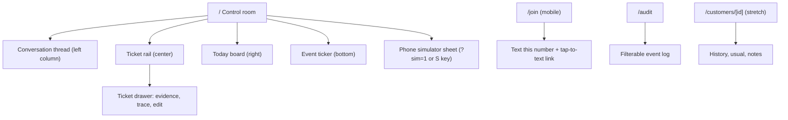

# Lane 1: Frontend

You build everything a judge looks at: the owner's control room, the judge join page, the audit page, and a phone simulator that keeps the demo alive if Photon fails. Design is 20% of the score and drives how judges perceive functionality and creativity, so this lane owns the "wow."

Read `planning/README.md` and `planning/ARCHITECTURE.md` first. You read data straight from Supabase (realtime) and send every action through the server.

## Ownership

| You own | You may read | Never edit |
| --- | --- | --- |
| `apps/web/**` | `packages/shared/**` (additive edits allowed with a `docs/DECISIONS.md` row) | `apps/server/**` |
| | `apps/server/**`, `packages/agents/**`, `data/seed/**` | `packages/agents/**`, `data/**`, `supabase/**`, root config |

Claim `apps/web/**` in `docs/STATUS.md` before writing code. Lane 1 belongs to **mojipao**.

## What you need from others, and when

| You need | From | When | Until then |
| --- | --- | --- | --- |
| `@boh/shared` merged | Lane 2 | Sat 1:15 PM | Copy the types from `ARCHITECTURE.md` into `apps/web/src/lib/contract-preview.ts` and delete it once the package lands |
| Supabase schema applied, `Database` type | Lane 2 | Sat 2:00 PM | Mock mode |
| `/dev/inbound`, `/approve`, `/reject` | Lane 2 | Sat 4:00 PM | Mock mode simulates them |
| Seeded data, real proposals | Lanes 2 and 3 | Sat 6:00 to 7:00 PM | Mock fixtures shaped like the seed |
| `POST /join` | Lane 2 | Sun 1:00 AM | Join page posts to a mock that returns a fake number |

## What others need from you

| Deliverable | Consumer | When |
| --- | --- | --- |
| Phone simulator working in live mode | Lanes 2 and 3 for integration testing | Sat 7:00 PM (M2) |
| Control room on real data | Demo | Sat 10:00 PM (M3) |
| Join page and QR | Demo | Sun 3:00 AM (M4) |

## Human-only steps

1. **Phone numbers.** Collect each teammate's iMessage phone number (E.164) for `DEMO_PERSONAS`, and give them to lane 2's human privately. Agree who plays Maya, Jun, and Priya.
2. **Deadline and rules.** Ask organizers for the exact submission deadline, the demo format (table judging or stage), the screen and connection available, and whether one title track plus several sponsored tracks is allowed. Update the Clock table in `planning/README.md` and `docs/CONTEXT.md`.
3. **Vercel (M4, optional).** Create a Vercel project from this repo with Root Directory `apps/web`, or deploy with the CLI (`vercel --cwd apps/web`) if the GitHub integration needs the repo owner's approval. Set the web env vars. Because the server runs on the demo laptop, the deployed site needs `SERVER_URL` pointed at the ngrok domain.
4. **Design review.** At M3 and M5, look at the control room on the actual demo screen (or a projector-sized window) and give your agent concrete fixes.
5. **Print the QR code** for `/join` or keep it full-screen on a second device for judges.

## Setup (Phase 0, Sat 12:30 to 1:30 PM)

1. Wait for lane 2's scaffold PR only if it lands within 15 minutes. Otherwise create the app in your own folder; the workspace glob picks it up later.
2. From the repo root:
   ```bash
   pnpm create next-app@latest apps/web --ts --tailwind --eslint --app --src-dir --import-alias "@/*" --use-pnpm --disable-git --skip-install
   ```
   Then set `"name": "@boh/web"` in `apps/web/package.json`, add `"@boh/shared": "workspace:*"` once it exists, add a `"typecheck": "tsc --noEmit"` script, and run `pnpm install` at the root.
3. In `apps/web/next.config.ts`, set `transpilePackages: ["@boh/shared"]`.
4. Initialize shadcn/ui inside `apps/web` (`pnpm dlx shadcn@latest init`) and add: `button`, `card`, `badge`, `tooltip`, `dialog`, `sheet`, `textarea`, `input`, `tabs`, `scroll-area`, `separator`, `sonner`, `skeleton`, `toggle-group`.
5. Install `@supabase/supabase-js`, `motion`, `lucide-react`, `date-fns`, `qrcode.react`.
6. Create `apps/web/.env.local` with `NEXT_PUBLIC_SUPABASE_URL`, `NEXT_PUBLIC_SUPABASE_ANON_KEY`, `NEXT_PUBLIC_DATA_MODE=mock`, `SERVER_URL`, `OWNER_TOKEN`.
7. `pnpm --filter @boh/web dev` and open `http://localhost:3000`.

## Design direction: "the pass"

In a restaurant kitchen, the pass is where tickets hang on a rail and nothing leaves until the chef checks it. That is exactly our control plane: agents write tickets, the owner calls them out. Use that metaphor everywhere. It fits the kitchen-themed tracks, makes the human-approval idea instantly understandable, and looks like nothing else at the hackathon.

### Visual language

| Token | Value | Use |
| --- | --- | --- |
| `--bg` | `#14110F` | App background, warm charcoal |
| `--panel` | `#1D1916` | Columns |
| `--line` | `#2E2824` | Dividers, borders |
| `--ticket` | `#F5EFE4` | Ticket paper |
| `--ink` | `#1B1714` | Text on tickets |
| `--muted` | `#9C9188` | Secondary text on dark |
| `--fg` | `#EEE7DD` | Primary text on dark |
| `--tomato` | `#E4572E` | Needs attention, risk flags, reject |
| `--amber` | `#F2A541` | Pending, executing |
| `--basil` | `#4FAE6A` | Approved, executed, paid |
| `--sky` | `#6BA4D8` | Customer messages, iMessage blue nod |

- Typography: Geist Sans for UI, Geist Mono (or JetBrains Mono) for ticket bodies, timestamps, order lines, and the event ticker.
- Tickets: paper color, slightly rounded (6px), a perforated top edge (CSS radial-gradient mask), a subtle drop shadow, and a 0.5° random rotation that straightens on hover.
- Motion: new tickets slide down onto the rail with a small bounce (spring, 250ms). Approve plays a green "SENT" rubber-stamp animation, then the ticket slides right into the done strip. Reject stamps "86'd" in tomato (kitchen slang for "removed"). Respect `prefers-reduced-motion`.
- Density: designed for a 1440×900 projector first and 1280 minimum. Font sizes no smaller than 13px on dark backgrounds; tickets use 15px body text so judges can read them from two meters away.
- Contrast: every text color meets WCAG AA on its background. Focus rings are 2px amber.

## Screen map



### `/`: control room

```
┌──────────────────────────────────────────────────────────────────────────────┐
│ LARCH & RYE  · Back of House     ● Intake ● Ops ● Guard    3 pending  $186 today  12:41 │
├───────────────┬──────────────────────────────────────────┬───────────────────┤
│ CONVERSATIONS │ THE PASS                                  │ TODAY · SAT 10/24 │
│               │ ┌──────────────┐ ┌──────────────┐         │ Pickups           │
│ ● Maya Chen   │ │ INTAKE · Maya│ │ OPS · reorder│         │  8:00 Jun ×40 ⚠   │
│   usual for…  │ │ Draft reply… │ │ Almond flour │         │  9:00 Maya ✓ paid │
│ ○ Jun Park    │ │ 2× Almond cr.│ │ 4 kg Cascade │         │                   │
│ ○ +1 206…     │ │ evidence ▸   │ │ evidence ▸   │         │ Stock             │
│               │ │ [A] [E] [R]  │ │ [A] [R]      │         │  Almond flour ▓▓░ │
│ thread view   │ └──────────────┘ └──────────────┘         │  Butter      ▓▓▓▓ │
│ (bubbles)     │ DONE ▸ ✓ ✓ ✓                               │  Oat milk    ▓▓▓░ │
├───────────────┴──────────────────────────────────────────┴───────────────────┤
│ 12:41:03 photon message.received Maya · 12:41:05 agent:intake understand 820ms …│
└──────────────────────────────────────────────────────────────────────────────┘
```

**Top bar**
- Shop name and product name.
- Agent status dots for Intake, Ops, and Guard: pulse amber while an `agent.step` event for that agent arrived in the last 5 seconds, steady basil otherwise, tomato if the last event for it is a failure.
- Counters: pending tickets, today's paid revenue (sum of `orders.total_cents - discount_cents` where `paid_at` is today).
- Connection indicator: realtime connected (basil) or polling fallback (amber).
- Live clock in the business timezone.

**Left column: conversations (320px)**
- List of conversations ordered by `last_message_at`, with customer name (or masked handle `+1 206 •••• 0100` for unknown), last message preview, relative time, and a dot if a pending ticket exists.
- Selecting one shows the thread: inbound bubbles in `--sky`-tinted dark, outbound in `--panel` with a small "approved by owner" caption. Simulated conversations show a "simulated" badge; iMessage ones show an iMessage badge.
- New inbound messages animate in and briefly highlight the conversation row.

**Center column: the pass (flex)**
- Pending proposals as tickets, newest first, wrapping in a grid of 2 to 3 columns.
- Ticket anatomy, top to bottom:
  1. Header strip: agent name (`INTAKE`, `OPS`), kind, customer name, relative time, confidence meter (5 segments).
  2. Risk flags as tomato chips with human labels: `new_customer` → "New customer", `allergy_mentioned` → "Allergy", `ingredient_shortfall` → "Short on stock", `injection_suspected` → "Suspicious message", and so on for every `RiskFlag`.
  3. For replies: the draft text in mono, with `{{payment_link}}` rendered as a pill "Square payment link (created on approve)". Order lines with quantity, name, and catalog price, a perk line if present, and the pickup time.
  4. For reorders: supplier, lines with quantity and unit, needed-by date, and a "simulated supplier" note.
  5. Evidence: up to 4 chips (`label: value`), "+N more" opens the drawer. Clicking a chip opens the drawer scrolled to that row with its source table and ID.
  6. Actions: Approve (A), Edit (E), Reject (R). Linked tickets (`parent_proposal_id`) show a small connector badge, "linked to Maya's reply."
- Ticket drawer (shadcn `Sheet`, right side): full draft (editable textarea in edit mode with a character count and a warning if `{{payment_link}}` was removed), all evidence, and the **trace**: every `agent.step` event for the trigger message in order, with step name, duration, and a one-line detail. This is the "how I got here" moment. Show it in the demo.
- Executing: amber shimmer on the ticket. Executed: green "SENT" stamp, then it moves to the done strip. Failed: tomato border, the error text, and a Retry button if lane 2 ships `/retry`.
- Done strip: the last 8 executed or rejected tickets as small stubs; clicking opens the drawer read-only.
- Empty state: an illustrated empty rail with "Quiet at the pass. Text the shop to see agents work," plus a "Open phone simulator" button.

**Right column: today (340px)**
- Pickups for the selected local day (tabs: Today, Tomorrow, Saturday): time, customer, item count, status chip (awaiting payment amber, paid basil), and a warning icon if the order's day has a shortfall.
- Stock: one bar per ingredient: on hand vs reorder point, with `on_order` as a hatched extension. Bars animate when realtime changes arrive, which happens on payment (deduction) and reorder approval (on order). This is where the judge sees their purchase change the business.
- Paid today total, and a small count of orders created by agents today.

**Bottom: event ticker (40px)**
- Live `events` stream in mono: time, actor, type, short subject. Auto-scrolls; pauses on hover. Clicking an item opens `/audit` filtered to that subject.

**Keyboard**
- `A` approve focused ticket, `E` edit, `R` reject, `J`/`K` move focus between tickets, `S` open the phone simulator, `?` shortcut help. Show a hint row under the rail.

### Phone simulator (sheet, `S` or `?sim=1`)

An iPhone-shaped panel with a persona picker (Maya, Jun, Priya, or a new number) and a message box. Sending calls your route handler, which calls `POST /dev/inbound`. Outbound replies for that simulated conversation appear in the same panel. Preset buttons for the demo lines: "the usual for Saturday 9am," "40 almond croissants Saturday," "2 almond croissants Sunday." This is both the integration test harness for every lane and the demo fallback.

### `/join`: judge onboarding (mobile-first)

1. Shop name, one sentence: "Text Larch & Rye like a regular. An AI drafts the reply; the owner approves it."
2. Name and phone (or iMessage email) inputs, a consent line ("We'll only reply to messages you send. Synthetic demo shop, no real orders."), and a submit button.
3. On success: big assigned number, a tap-to-text button using `sms:<number>&body=Hi! Can I order for Saturday?` (opens iMessage on iPhone), and a note: "Send from the same number you entered, as an iMessage."
4. Errors: invalid number, assignment failed ("Ask the team at the table"), rate limited.
5. On the control room, show a small QR card linking to `/join` in the top bar's overflow menu, and full-screen QR at `/join/qr` for a second screen.

### `/audit`

A full-height table of `events`: time, actor, type, subject, and expandable JSON data. Filters for actor, type, and subject. A summary bar: "N actions executed · N approved by the owner · 0 sent without approval." That last number is the trust claim; it is computed from events, not hard-coded. Linked from the ticker and from the trust section of the pitch.

### `/customers/[id]` (stretch)

Profile with name, notes, computed usual order, last visit, order history list labeled "synthetic history," and conversations.

## Architecture inside `apps/web`

```
apps/web/src/
├── app/
│   ├── page.tsx                 # control room (client component shell)
│   ├── join/page.tsx
│   ├── join/qr/page.tsx
│   ├── audit/page.tsx
│   ├── customers/[id]/page.tsx  # stretch
│   └── api/
│       ├── proposals/[id]/approve/route.ts   # POST → server with OWNER_TOKEN
│       ├── proposals/[id]/reject/route.ts
│       ├── dev/inbound/route.ts
│       └── join/route.ts                      # no token; server rate-limits
├── components/
│   ├── top-bar.tsx, agent-status.tsx
│   ├── conversations/{list,thread}.tsx
│   ├── pass/{rail,ticket,ticket-drawer,trace,evidence-chip,risk-chip,done-strip,stamp}.tsx
│   ├── today/{pickups,stock-bars,revenue}.tsx
│   ├── ticker.tsx
│   └── phone-simulator.tsx
├── lib/
│   ├── supabase.ts       # browser client (anon key)
│   ├── data/
│   │   ├── source.ts     # interface DataSource { subscribe…, list… }
│   │   ├── live.ts       # Supabase select + realtime channels
│   │   └── mock.ts       # in-memory store + scripted timeline
│   ├── actions.ts        # approve/reject/simulate via /api routes
│   ├── format.ts         # money, masked handles, local times
│   └── flags.ts          # RiskFlag → label, icon, color
└── mocks/fixtures.ts     # shaped like data/seed and the contract
```

### Data layer

- One `DataSource` interface so every component works the same in mock and live modes. Choose by `NEXT_PUBLIC_DATA_MODE`.
- Live mode: on mount, select the initial rows (pending and recent proposals, today's and upcoming orders with items, ingredients, last 50 events, recent conversations and messages). Then subscribe to `postgres_changes` on `conversations`, `messages`, `proposals`, `orders`, `ingredients`, `events` and merge inserts and updates into a client store (React context with a reducer, or Zustand).
- If the realtime channel isn't `SUBSCRIBED` within 5 seconds, or drops, poll the same queries every 3 seconds and show the amber indicator.
- `order_items` and `products` are not realtime; fetch items when an order arrives and cache products once.
- Mock mode: the scripted timeline plays the three demo scenarios (Maya usual, Jun catering with linked reorder, Priya allergy) with realistic delays, including trace events. Approve and reject update the mock store and play the same animations. This lets you build the whole UI before the backend exists, and it is the last-resort demo fallback.

### Actions

- Route handlers forward to `${SERVER_URL}` with `x-owner-token: ${OWNER_TOKEN}` from server-side env. Never expose the token to the browser.
- Approve is optimistic: set the ticket to executing locally, then reconcile with the realtime update or the response. On `409`, show "Already handled" and refresh. On `502`, show the server's error on the ticket.
- Edits send `{ editedText }`. Disable Approve if the edited text is empty or over 1200 characters.

## Phases

### Phase 1: static control room on mocks (Sat 1:30 to 4:00 PM, M1)

1. Tokens in `globals.css`, fonts, the three-column layout at 1440×900.
2. Ticket component with every section, flags, evidence, and the confidence meter, rendered from mock fixtures for all three scenarios.
3. Conversations list and thread, today board, ticker, all from mocks.
4. Approve, edit, and reject in mock mode with stamp animations.
5. PR and merge. Handoff: "UI runs in mock mode: `pnpm --filter @boh/web dev`."

### Phase 2: live data and the simulator (Sat 4:00 to 7:00 PM, M2)

1. `live.ts` data source with realtime and polling fallback.
2. API route handlers for approve, reject, and simulated inbound.
3. Phone simulator in live mode.
4. Test with lane 2's server on stub agents, then live agents: send "the usual for Saturday 9am" as Maya from the simulator, see the ticket within 8 seconds, approve, see the outbound message in the simulator and the thread.
5. PR and merge. Tell the other lanes in `docs/STATUS.md` that the simulator is their test harness.

### Phase 3: the real loop (Sat 7:00 to 10:00 PM, M3)

1. iMessage conversations render with real names and handles masked for unknown numbers.
2. Orders flip from awaiting payment to paid in realtime; stock bars animate on deduction.
3. Ticket drawer with the trace from `agent.step` events.
4. Run the full sequence from `planning/README.md` on a real phone with lanes 2 and 3. Tag `v-core` together.

### Phase 4: depth (Sat 10:00 PM to Sun 3:00 AM, M4)

1. Linked tickets (reply plus reorder), reorder ticket layout, on-order hatching in stock bars.
2. `/join` and `/join/qr` against lane 2's `/join`.
3. `/audit` with the "0 sent without approval" summary.
4. Agent status dots, keyboard shortcuts, empty, loading (skeletons), and error states.
5. Masked handles for any customer without a name.

### Phase 5: polish (Sun 3:00 to 7:00 AM, M5)

1. Visual pass on the projector-size window: alignment, spacing on an 8px grid, consistent radii, nothing truncated awkwardly.
2. Motion tuning; reduced-motion support.
3. Lighthouse accessibility score ≥ 90 on `/` and `/join`; fix contrast and labels.
4. A favicon and title, and an Open Graph image for the Devpost link.
5. Optional Vercel deploy pointing at the demo host's ngrok URL.
6. Screenshots for Devpost: the pass with three tickets, the drawer with trace, the paid order with stock change, `/join` on a phone, `/audit`.

## Checks before each PR

- `pnpm --filter @boh/web typecheck` and `pnpm --filter @boh/web lint`.
- Mock mode and live mode both load without console errors.
- The three demo scenarios render correctly in mock mode.
- Screenshot of the changed screen in the PR description.

## Risks and fallbacks

| Risk | Fallback |
| --- | --- |
| Realtime doesn't fire | Polling every 3 seconds, amber indicator |
| Server is down on demo | Mock mode timeline, presented honestly as a recorded flow |
| Projector washes out colors | Test early; raise ticket contrast and font weight |
| Too many tickets clutter the rail | Max 6 visible, the rest behind "+N pending" |

## When you stop

Update the lane 1 row in `docs/STATUS.md` with what screens work in which mode, the run command, and what is unfinished. Push to `main`.
